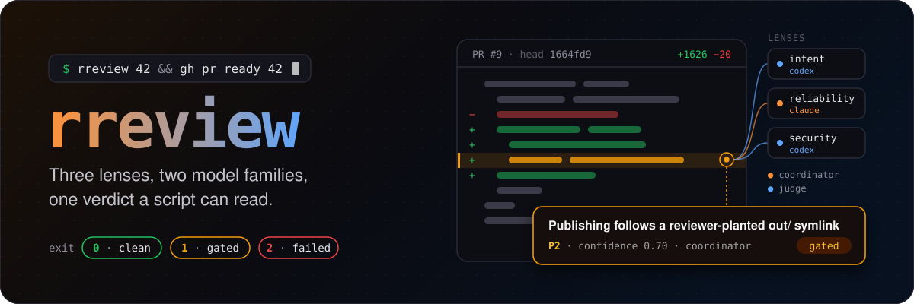
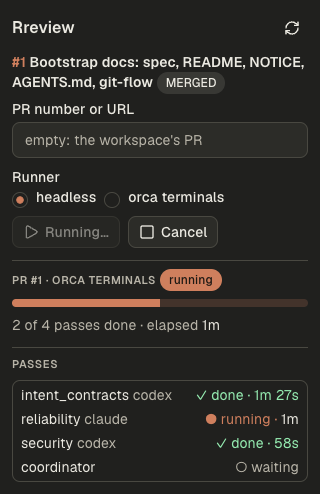
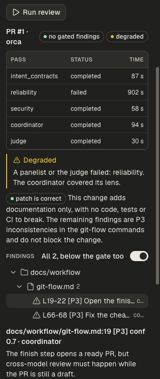
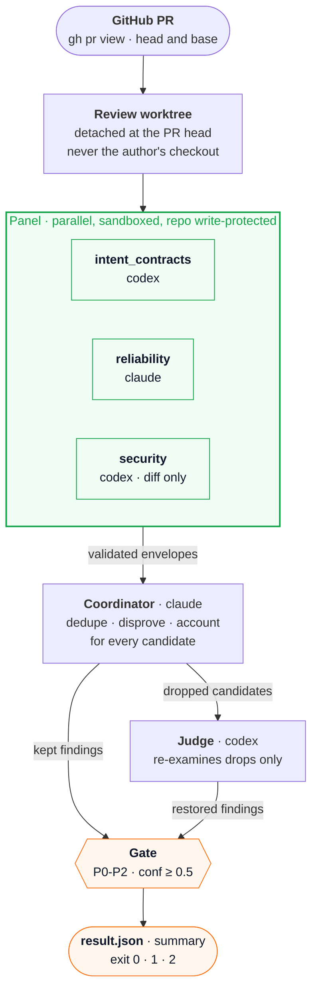

<p align="center">
  
</p>

<h3 align="center">An isolated, cross-model panel review of a GitHub pull request</h3>

<p align="center">
  
  
  
  
  
  
  
</p>

<p align="center">
  <a href="#-recent-updates"><b>Recent updates</b></a> ·
  <a href="#-key-features"><b>Key features</b></a> ·
  <a href="#-quick-start"><b>Quick start</b></a> ·
  <a href="#-how-it-works"><b>How it works</b></a> ·
  <a href="orca-plugin/README.md"><b>Rreview Orca plugin</b></a> ·
  <a href="docs/VISION-AND-SPEC.md"><b>Spec</b></a> ·
  <a href="#-read-next"><b>Read next</b></a>
</p>

<br>

`rreview <PR>` gives a pull request an independent review before it is marked ready. Three
**lenses** review it in parallel, a **coordinator** tries to disprove every candidate finding, and
a **judge** of the other model family re-examines only the dropped ones. Reviewers run through the
official `claude` and `codex` CLIs on your own subscriptions, **isolated** from your personal agent
config, and kept from changing your repo **by the OS sandbox**, not by the prompt. The exit code says whether anything
cleared the gate, so a script or an agent can act on it.

<p align="center">
  
  &nbsp;
  
  <br>
  <sub>The Rreview Orca plugin on a real review: each pass while it runs, then the verdict and the findings.</sub>
</p>

## 📣 Recent updates

### 🔥 2026.11.19: rreview 0.1.0, the first release
- **A cross-model panel reviews your PR**: `rreview <pr>` runs three lenses (intent and contracts,
  reliability, security) on Claude and Codex, then a coordinator and a judge, and gates the
  findings into `result.json` (exit 0 none gated, 1 gated, 2 failed).
- **Reviewers cannot change your repo**: the sandbox denies writes to the review worktree and its
  git dir, reviewers inherit only an allowlist of environment variables and none of your shell
  startup files, and `rreview doctor` checks these boundaries on your machine. They can still read
  files outside the denied paths, your dotfiles included.
- **Watch the review or run it headless**: `--runner orca` puts every reviewer in a visible Orca
  terminal, and the runner gives up on a pass stuck on a permission dialog instead of waiting out
  its timeout.
- **Run and cancel from Orca**: the Orca plugin reviews the focused workspace's PR, lists the
  findings with the verdict first, sends the ones you pick to an agent you choose in that workspace, and cancels
  a run.
- **Upgrade note**: tested with Claude Code 2.1.316, codex-cli 0.167.0 and Orca 1.4.262 on macOS.
  On Linux, Claude's sandbox needs bubblewrap and socat. The default gate (P0-P2 and confidence
  >= 0.5) is provisional; review quality is the focus of 0.2.0.
  [Release notes](https://github.com/decadance-dance/rreview/releases/tag/0.1.0)

## 🚀 Key features

### 🔍 A panel, not a single reviewer
> *Three lenses look for defects, a coordinator tries to disprove each one, and the other model family re-checks every drop.*

* **Fixed lenses in parallel**: each lens is one pass with its own procedure, adapted from
  [block/review](https://github.com/block/review). The security lens is blind: it sees the diff
  only, never the PR text.
* **Every candidate is accounted for**: the coordinator dedupes by root cause, drops a candidate
  only with cited counter-evidence, and gives each candidate id exactly one fate, or the review fails.
* **Cross-model by construction**: the judge never shares the coordinator's model family; a
  mapping that would give them the same one is refused before any work. `--author codex` flips
  the defaults when Codex wrote the change.
* **A gate and an exit code**: findings at P0-P2 with confidence >= 0.5 are gated (`--gate`
  moves the bar, `--all` reports every kept and restored finding); exit 0 means none, 1 means some, 2 means the review failed.

| Lens | Looks for | Sees | Default agent |
|---|---|---|---|
| `intent_contracts` | Does the PR do what it says; contracts, compatibility, edge cases, tests that fail when the logic breaks | diff, PR text, task criteria (`--context-file`) | codex |
| `reliability` | Failure at each call, partial success, races, cleanup, unbounded growth, rollback | diff, PR text | claude |
| `security` | Trust boundaries, authz, injection, secrets, supply chain | diff only | codex |

### 🔒 Reviewers that cannot change your repo
> *Isolation is enforced by the OS and checked on your machine, not asked for in a prompt.*

* **Write-protected by the sandbox**: writes to the review worktree and its git dir are denied,
  so a reviewer cannot edit, commit or branch; each pass gets its own scratch dir for its reply.
  A Claude launch fails closed when its sandbox cannot start or a settings file would weaken it.
* **Your setup stays out**: no personal `CLAUDE.md`, `AGENTS.md`, plugins, skills, hooks or MCP,
  no shell startup files, and only an allowlist of environment variables (it passes proxy
  credentials and Claude's OAuth token when they are set).
* **The PR is evidence, not instructions**: the reviewed repo's `AGENTS.md`, the PR body and the
  task text reach reviewers as untrusted data.
* **`rreview doctor` checks it**: a self-test on a throwaway repo through the same launch code a
  review uses (writes, commits and branches fail, a planted hook does not fire, startup files stay
  out); a check passes only when the effects on disk and the agent's own logs agree.

### 🖥️ Headless or in plain sight
> *The same review runs like a CI job or with every reviewer in a terminal you can watch.*

* **Headless by default**: reviewers run as child processes; `--json` prints `result.json`, and
  `rreview show <pr>` prints the latest result again.
* **Orca runner**: `--runner orca` opens each pass in a visible [Orca](https://github.com/stablyai/orca)
  terminal (the Orca app must be running, with this repo added to it, and the `orca` CLI on `PATH`), and the [Rreview Orca plugin](orca-plugin/README.md) runs a review from a sidebar panel.
* **Stopping cleans up**: Ctrl-C, SIGTERM or the plugin's Cancel stops every reviewer, removes the
  review worktree (unless `--keep-worktree`) and, with the Orca runner, its branch and the
  reviewers' terminals, then exits 2. A cleanup step that fails is reported and can leave that
  resource behind. Run dirs are private (0700).

## ⚡ Quick start

You need macOS (the tested platform; Linux is untested, and Claude's sandbox there needs bubblewrap
and socat), [rustup](https://rustup.rs/) with a stable toolchain, `zsh`, and the
[`gh`](https://cli.github.com/), [`claude`](https://docs.anthropic.com/en/docs/claude-code) and
[`codex`](https://github.com/openai/codex) CLIs, each logged in. No API keys: reviewers run on
your Claude and ChatGPT subscriptions. Reviewers use the Claude config and the Codex login of the
process that runs rreview: `$CLAUDE_CONFIG_DIR`, else `~/.claude`, and the `auth.json` in
`$CODEX_HOME`, else `~/.codex`; each Codex pass gets a fresh Codex home holding only that login,
so your Codex config does not apply. Without zsh rreview refuses to start a Claude reviewer, and
without a working sandbox Claude exits at startup.

```bash
# 1. Install the latest release
cargo +stable install --git https://github.com/decadance-dance/rreview --branch main --locked

# 2. Check the logins and that reviewer isolation holds on this machine
rreview doctor

# 3. Review a PR from a clone of its repository (number or URL)
rreview 42
echo $?            # 0 nothing gated, 1 gated findings, 2 the review failed
rreview show 42    # print the latest result again; --json for result.json
```

A review takes a few minutes (2-5 in the [calibration](docs/calibration.md)). It prints its run
dir on stderr; `result.json`, the progress log and each pass's validated output stay there.

> [!WARNING]
> Isolation keeps reviewers from changing your repo; it does not keep your files secret. A
> reviewer can read files outside the denied paths, your dotfiles included, and reach the network
> beyond the sandbox's deny rules. With `--runner orca`, answering Claude's workspace
> trust dialog is recorded in your Claude config (`.claude.json`), as accepting it by hand would be.

## 🧭 How it works



- **Prepare**: rreview resolves the PR with `gh`, fetches only missing commits, and checks the head
  out into a detached worktree under its run dir. The worktree is removed at the end, also after a
  failure or a stop.
- **Panel**: three passes in parallel, each with its own sandbox, settings and scratch dir. Every
  reply is decoded strictly: unknown fields, paths outside the diff or one malformed candidate
  reject it, and a reply that fails validation gets one more turn with the error.
- **Coordinator and judge**: the coordinator covers a failed lens and marks the run `degraded`;
  if it fails, the review fails. The judge runs only when something was dropped; if it fails,
  the coordinator's findings stand.
- **Deliver**: kept and restored findings are merged, deduped and gated into `result.json`, with
  every pass's agent, model, status and time.

**→ [Vision and spec](docs/VISION-AND-SPEC.md)** has the pipeline, the isolation rules, the data
contract and the CLI in full.

## 📚 Read next

| If you want to… | Open |
|---|---|
| Know exactly what rreview does, its CLI, `result.json` and exit codes | [Vision and spec](docs/VISION-AND-SPEC.md) |
| Run reviews from Orca's sidebar | [Rreview Orca plugin](orca-plugin/README.md) |
| See how well it finds real defects, and why the gate is 0.5 | [Calibration](docs/calibration.md) |
| Contribute: rules for people and coding agents | [`AGENTS.md`](AGENTS.md) |
| Branch, open a PR, get the cross-model review | [Git flow](docs/workflow/git-flow.md) |
| Cut a release or ship a hotfix | [Releasing](docs/workflow/releasing.md) |

<details>
<summary><b>Glossary</b></summary>
<br>

| Term | Meaning |
|---|---|
| **Lens** | One panelist's fixed point of view: `intent_contracts`, `reliability` or `security` |
| **Pass** | One reviewer run: a lens, the coordinator or the judge, on one agent |
| **Candidate** | A defect a lens reports, with a host-assigned id such as `reliability-2` |
| **Coordinator** | The pass that dedupes candidates and tries to disprove each one, keeping or dropping it with evidence |
| **Judge** | The pass of the other model family that re-examines only the dropped candidates and may restore them |
| **Finding** | A kept or restored defect with its file, lines, priority (P0-P3) and confidence |
| **Gate** | The bar a finding must clear to count: by default P0-P2 and confidence >= 0.5 |
| **Degraded** | A lens or the judge failed; the review still finished |
| **Run dir** | Where one review keeps its worktree, progress log, validated outputs and `result.json` |
| **Runner** | How reviewers run: `headless` child processes or visible `orca` terminals |

</details>

<details>
<summary><b>Working in this repository</b></summary>
<br>

```bash
bin/check                              # the merge gate: fmt, clippy, tests, the Orca plugin's check and tests (needs zsh and the orca CLI)
cargo test <name>                      # one test first; agents are faked, no logins needed
RREVIEW_LIVE=1 cargo test -- --ignored # live tests against your real claude and codex logins
cargo run -- doctor                    # after any change to how a reviewer is launched or isolated
```

- **Branches** follow [git-flow](docs/workflow/git-flow.md): `feature/<n>-<slug>` off `develop`,
  merged back through a pull request with a merge commit once `ci-ok` is green and a reviewer of
  the other model family has reviewed it. Releases and hotfixes: [releasing](docs/workflow/releasing.md).
- **Tasks** live in [GitHub Issues](https://github.com/decadance-dance/rreview/issues); every
  branch works on one.
- Files, comments, commits and issues are in English.

</details>

<sub>The review pipeline and its prompts are adapted from [block/review](https://github.com/block/review) (Apache-2.0); see [NOTICE](NOTICE). rreview is licensed under [Apache-2.0](LICENSE).</sub>
